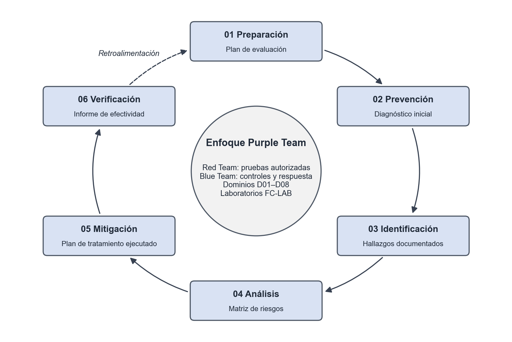

# VioHex

Framework metodológico para la evaluación, análisis y fortalecimiento de la ciberseguridad. Versión 0.1.

VioHex organiza una evaluación en seis fases: preparación, prevención, identificación, análisis, mitigación y verificación. Combina los enfoques Red Team, Blue Team y Purple Team. Cada laboratorio se documenta con una ficha estandarizada que lo vincula con una fase, un dominio, sus evidencias y un criterio de aceptación verificable.



## Fases

| Fase | Producto |
| --- | --- |
| [01 Preparación](framework/fases/01-preparacion.md) | Plan de evaluación |
| [02 Prevención](framework/fases/02-prevencion.md) | Diagnóstico inicial |
| [03 Identificación](framework/fases/03-identificacion.md) | Hallazgos documentados |
| [04 Análisis](framework/fases/04-analisis.md) | Matriz de riesgos |
| [05 Mitigación](framework/fases/05-mitigacion.md) | Plan de tratamiento ejecutado |
| [06 Verificación](framework/fases/06-verificacion.md) | Informe de efectividad |

## Laboratorios

| ID | Laboratorio | Dominio |
| --- | --- | --- |
| [FC-LAB-001](laboratorios/lab-01-shell/) | Comandos Shell y Kali Linux | D01 |
| [FC-LAB-002](laboratorios/lab-02-dns/) | DNS Footprinting con nslookup y dig | D02 |
| [FC-LAB-003](laboratorios/lab-03-httrack/) | Clonación controlada HTTrack | D03 |
| [FC-LAB-004](laboratorios/lab-04-esteganografia/) | Esteganografía con Steghide, partes 1 a 3 | D06 |
| [FC-LAB-005](laboratorios/lab-05-ingenieria-social/) | Ingeniería social | D05 |
| [FC-LAB-006](laboratorios/lab-06-maltego/) | Maltego | D02 |
| [FC-LAB-007](laboratorios/lab-07-burp/) | Burp Suite | D03/D04 |

Los dominios están en [framework/matrices/dominios.md](framework/matrices/dominios.md).

## Estructura

```
docs/            Documento del framework (.docx) y sus secciones en Markdown
framework/
  fases/         Una especificación por fase
  matrices/      Dominios, referentes, casos de prueba, hallazgos, evidencias y mitigación
  protocolos/    Gestión del repositorio y guía de GitHub
laboratorios/    Una carpeta por laboratorio: README (ficha), procedimiento, evidencias, scripts, resultados
plantillas/      Ficha de laboratorio, caso de prueba y hallazgo
casos-estudio/   Evaluaciones completas sobre escenarios autorizados
resultados/      Informes consolidados y métricas por versión
scripts/         Utilidades (hashes de evidencias)
```

## Agregar un laboratorio

1. Crear `laboratorios/lab-NN-<tema>/` con las subcarpetas `procedimiento`, `evidencias`, `scripts` y `resultados`.
2. Copiar [plantillas/ficha-laboratorio.md](plantillas/ficha-laboratorio.md) como su `README.md`.
3. Registrar sus casos de prueba y hallazgos en `framework/matrices/`.
4. Trabajar en una rama `feature/lab-NN` y abrir un Pull Request (ver [guía de GitHub](framework/protocolos/guia-github.md)).

## Publicación segura

No se suben credenciales, tokens, datos personales, información de terceros ni capturas sin anonimizar (sección 11.2). Las pruebas solo se ejecutan sobre sistemas propios, entornos de práctica o con autorización escrita.

## Autor

Diego Alejandro Alberto Cáceres.
