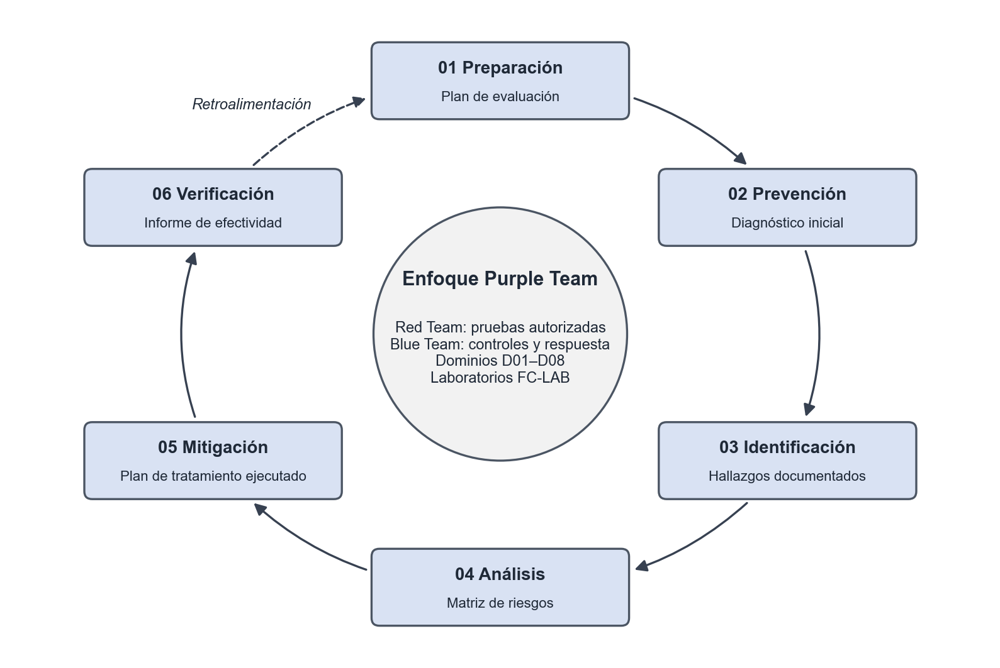
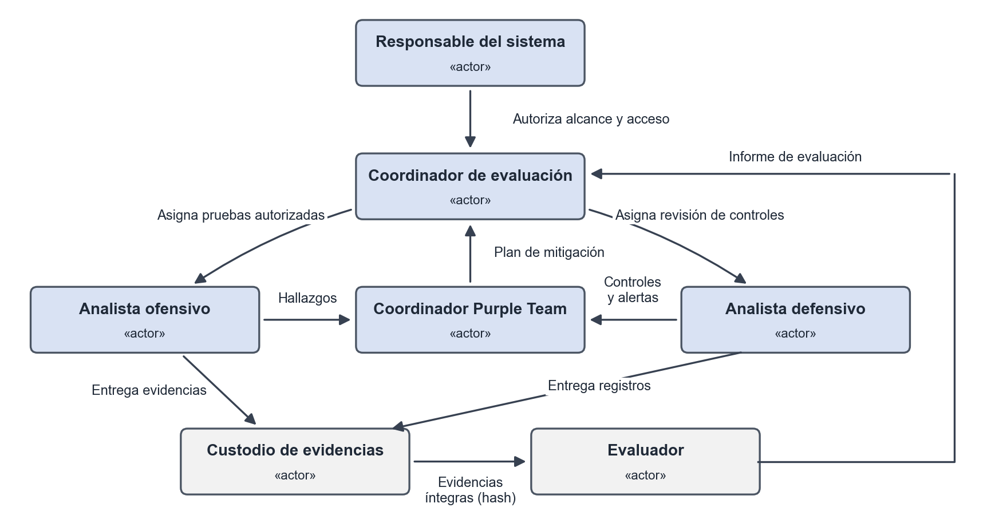

# 6. ARQUITECTURA METODOLÓGICA

| Fase | Finalidad | Producto |
| --- | --- | --- |
| 01 Preparación | Definir objetivos, autorización, activos y reglas | Plan de evaluación |
| 02 Prevención | Examinar controles y establecer línea base | Diagnóstico inicial |
| 03 Identificación | Ejecutar reconocimiento y pruebas controladas | Hallazgos documentados |
| 04 Análisis | Evaluar evidencia, impacto y riesgo | Matriz de riesgos |
| 05 Mitigación | Aplicar medidas de tratamiento | Plan de tratamiento ejecutado |
| 06 Verificación | Repetir pruebas y comparar resultados | Informe de efectividad |

Figura 1. Arquitectura metodológica de VioHex: ciclo de seis fases coordinado con enfoque Purple Team.

La arquitectura es iterativa: la verificación retroalimenta la preparación y las actividades de prevención. Los procedimientos pueden adaptarse al dominio y al alcance aprobado.

# 8. ACTORES Y RESPONSABILIDADES

| Actor | Responsabilidad |
| --- | --- |
| Responsable del sistema | Autoriza alcance y facilita acceso legítimo. |
| Coordinador de evaluación | Planifica, supervisa y aprueba procedimientos. |
| Analista ofensivo | Ejecuta pruebas autorizadas y registra resultados. |
| Analista defensivo | Revisa controles, registros y acciones correctivas. |
| Coordinador Purple Team | Integra aprendizajes y verifica mejoras. |
| Custodio de evidencias | Preserva integridad, acceso y trazabilidad. |
| Evaluador | Revisa criterios y consistencia de resultados. |

Figura 2. Interacción de responsabilidades entre los actores de VioHex (diagrama de colaboración con notación de actores UML).

El responsable del sistema autoriza el alcance y el acceso. El coordinador de evaluación asigna las pruebas autorizadas al analista ofensivo y la revisión de controles al analista defensivo. Ambos entregan evidencias y registros al custodio, que preserva su integridad mediante hashes. El coordinador Purple Team integra hallazgos y controles en el plan de mitigación, y el evaluador revisa las evidencias íntegras y emite el informe de evaluación. En los laboratorios académicos varios roles recaen en una misma persona, como se indica en las fichas de la sección 10.3.
