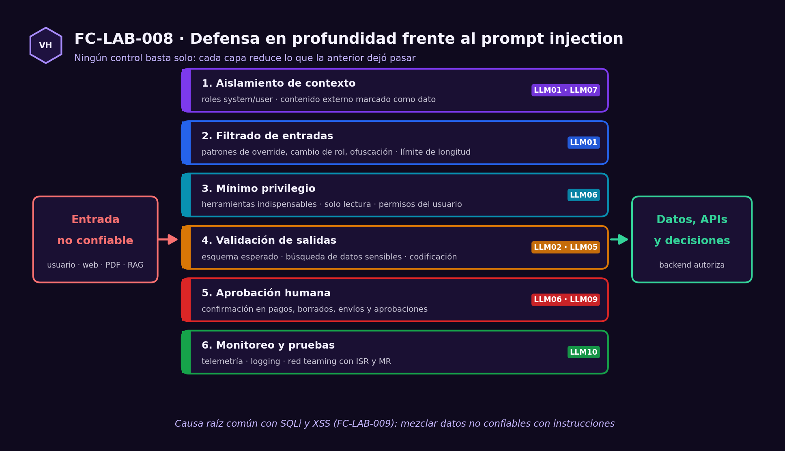

# FC-LAB-008. Prompt injection en aplicaciones con LLM

| Campo | Descripción / dato requerido |
| --- | --- |
| Identificador | FC-LAB-008 |
| Nombre y versión | Informe contextual de prompt injection en aplicaciones con modelos de lenguaje. v1.0, 13/11/2026. |
| Objetivo | Caracterizar el prompt injection (LLM01:2025), relacionarlo con las inyecciones clásicas y la ingeniería social, y definir buenas prácticas ofensivas y defensivas, una taxonomía de casos de prueba y métricas para evaluar sistemas con LLM. |
| Dominio y fase | D08 Seguridad de IA, con relación a D05 Factor humano. Fases 01 Preparación (taxonomía, reglas de prueba y métricas), 02 Prevención (controles de diseño) y 05 Mitigación (estrategias). |
| Roles | Analista ofensivo (diseño de casos de prueba): Diego Alberto. Analista defensivo (controles): Diego Alberto. Revisor: Diego Alberto. |
| Entorno y autorización | Laboratorio documental: análisis de la guía del curso, del OWASP Top 10 para LLM (2025) y de MITRE ATLAS (AML.T0051 y AML.T0054). No se probó ningún sistema; las pruebas que se deriven deben hacerse sobre un sistema propio o autorizado, aislado de producción y con datos ficticios. |
| Entradas | Taxonomía de la guía, plantilla estructural de caso de prueba y prompts neutros sin datos reales. |
| Procedimiento | 1. Clasificar el ataque por objetivo, vector, técnica lingüística, profundidad e impacto. 2. Relacionar cada categoría con el OWASP Top 10 para LLM. 3. Formular cinco buenas prácticas ofensivas y cinco defensivas. 4. Responder las cinco preguntas del informe. 5. Definir la matriz de evaluación y las métricas. Detalle en [procedimiento/taxonomia.md](procedimiento/taxonomia.md). |
| Evidencias | Laboratorio sin capturas: la evidencia es el informe entregado, en [resultados/informe.pdf](resultados/informe.pdf), junto con la taxonomía, la matriz y el script de métricas. |
| Criterio de aceptación | Cada categoría de la taxonomía tiene su riesgo OWASP asociado y un control que la mitiga, y la matriz permite calcular ISR y MR de forma repetible con [scripts/metricas.py](scripts/metricas.py). |
| Análisis defensivo | El prompt injection comparte la causa raíz de la inyección SQL y del XSS del FC-LAB-009: mezclar datos no confiables con instrucciones. Como el lenguaje natural no admite un equivalente a las consultas parametrizadas, la defensa es en profundidad: aislamiento de contexto, validación de entradas y salidas fuera del modelo, mínimo privilegio, aprobación humana y monitoreo. Detalle en [resultados/controles.md](resultados/controles.md). |
| Resultado | Taxonomía de casos de prueba, plantilla de matriz de evaluación ([resultados/plantilla-matriz.csv](resultados/plantilla-matriz.csv)), métricas ISR y MR, y diez buenas prácticas. Pendiente para las fases 03 y 06: aplicar la matriz a un sistema con LLM autorizado. |

Documentos: informe entregado: [informe](resultados/informe.pdf). No se dispone de la guía del docente.

Autor del laboratorio: Diego Alejandro Alberto Cáceres. Corresponde al laboratorio 8 del curso. En este laboratorio académico el autor asumió todos los roles, incluido el de revisor, como admite la sección 3.
