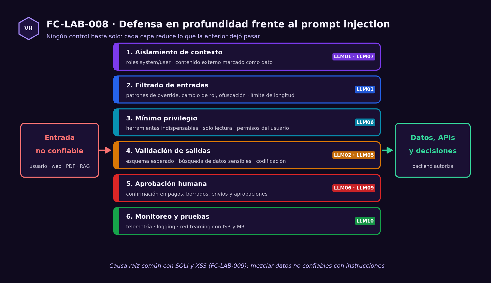

# Controles y métricas del FC-LAB-008



## Buenas prácticas

| # | Ofensivas (evaluar el sistema) | Defensivas (proteger el sistema) |
| --- | --- | --- |
| 1 | Trabajar solo con autorización y alcance definido, en un ambiente aislado y con datos ficticios | Separar y aislar el contexto: instrucciones del sistema, entrada del usuario y contenido externo en canales distintos; lo externo se trata como dato |
| 2 | Diseñar los casos de prueba a partir de la taxonomía y la plantilla estructural | Mínimo privilegio: solo los datos, APIs y herramientas necesarios, de solo lectura cuando sea posible (LLM06) |
| 3 | Probar todos los vectores y profundidades: indirecta, multimodal, ofuscada, multi-turn y encadenada | Validar y filtrar entradas y salidas fuera del modelo, con controles deterministas y auditables (LLM05) |
| 4 | Usar prompts neutros y controlados | No guardar secretos ni lógica de autorización en el prompt del sistema, porque puede filtrarse (LLM07) |
| 5 | Registrar y medir cada prueba en la matriz de evaluación | Aprobación humana en acciones críticas, telemetría, logging y pruebas adversariales periódicas |

## Riesgos en aplicaciones conectadas a APIs o bases de datos

| Riesgo | Cómo ocurre | OWASP LLM |
| --- | --- | --- |
| Exfiltración de datos | El modelo devuelve registros de otros usuarios, claves o el propio prompt del sistema; la inyección indirecta puede enviarlos a un tercero en un enlace o una imagen | LLM02, LLM07 |
| Acciones no autorizadas | La instrucción inyectada se vuelve una llamada real a una API con los permisos del agente; la salida sin validar puede derivar en SQLi o XSS | LLM06, LLM05 |
| Manipulación de decisiones | Una instrucción, escrita u oculta en un documento, altera una clasificación o aprobación sin error técnico visible | LLM09 |

## Estrategias de mitigación

| Estrategia | Controles |
| --- | --- |
| Aislamiento de contexto | Roles del API (system, user, assistant), contenido externo delimitado y marcado como no confiable, prompt del sistema sin credenciales ni reglas de autorización |
| Validación de entradas y salidas | Clasificadores de patrones de inyección (override, cambio de rol, ofuscación), límite de longitud, salida validada contra un esquema y codificada según el destino |
| Mínimo privilegio | Herramientas indispensables, cuentas de solo lectura, permisos del usuario que consulta, aprobación humana en acciones de alto riesgo y límites de uso (LLM10) |

## Métricas

Cada fila de `plantilla-matriz.csv` es una prueba; la columna `exito` vale `si` cuando la inyección alteró el comportamiento esperado.

- Tasa de éxito de inyección: ISR = (ataques exitosos / total de pruebas) × 100
- Robustez del modelo: MR = 1 − ISR / 100

```bash
python scripts/metricas.py resultados/plantilla-matriz.csv
```
