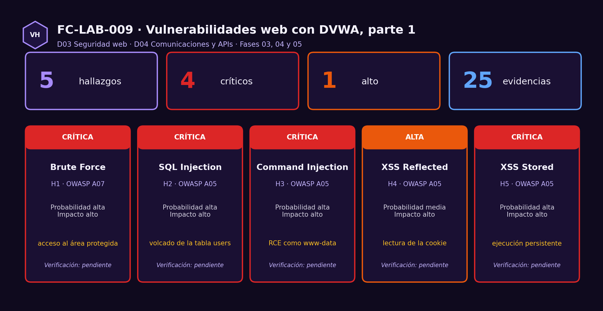

# FC-LAB-009. Vulnerabilidades web con DVWA, parte 1

| Campo | Descripción / dato requerido |
| --- | --- |
| Identificador | FC-LAB-009 |
| Nombre y versión | Vulnerabilidades web con DVWA, parte 1: fuerza bruta, inyección SQL, inyección de comandos y XSS. v1.0, 13/11/2026. |
| Objetivo | Explotar de forma controlada cinco vulnerabilidades del OWASP Top 10:2025 en una aplicación deliberadamente insegura, explicar su causa técnica y plantear su mitigación. |
| Dominio y fase | D03 Seguridad web y D04 Comunicaciones y APIs. Fases 03 Identificación, 04 Análisis y 05 Mitigación (plan de tratamiento). |
| Roles | Analista ofensivo (explotación): Diego Alberto. Analista defensivo (mitigación): Diego Alberto. Revisor: Diego Alberto. |
| Entorno y autorización | DVWA (Damn Vulnerable Web Application, GPL v3) en el contenedor `vulnerables/web-dvwa` sobre Kali Linux, publicado solo en `localhost:8080`. Es una aplicación diseñada para la práctica; no se probó ningún sistema de terceros. |
| Entradas | Credenciales por defecto de DVWA, nivel de seguridad Low y las cargas de prueba de [procedimiento/pasos.md](procedimiento/pasos.md). |
| Procedimiento | 1. Levantar DVWA con [scripts/levantar-dvwa.sh](scripts/levantar-dvwa.sh). 2. Crear la base de datos y fijar el nivel Low. 3. Brute Force. 4. SQL Injection. 5. Command Injection. 6. XSS Reflected. 7. XSS Stored. Diagrama en [procedimiento/flujo-pruebas.png](procedimiento/flujo-pruebas.png). |
| Evidencias | 25 capturas en [evidencias/](evidencias/), numeradas como las partes del informe; el valor de la cookie `PHPSESSID` está tapado. Hashes SHA-256 en `evidencias/hashes.csv`. |
| Criterio de aceptación | Cada módulo muestra la respuesta normal y la respuesta alterada por la carga: acceso al área protegida, listado completo de usuarios, salida de comandos del servidor y ejecución de scripts en el navegador. |
| Análisis defensivo | Cinco hallazgos, cuatro críticos y uno alto, en [resultados/hallazgos.md](resultados/hallazgos.md). Causas comunes: la entrada se concatena en consultas, comandos y HTML sin validar ni codificar, y la cookie de sesión no lleva `HttpOnly`. La mitigación propuesta es defensa en profundidad según OWASP. |
| Resultado | Matriz de hallazgos con severidad según la rúbrica del Anexo B y plan de mitigación. Pendiente para la fase 06: repetir las pruebas en el nivel Impossible y registrar si cada carga queda bloqueada. |

Documentos: guía del docente: [guía](procedimiento/guia.pdf); informe entregado: [informe](resultados/informe.pdf).

Autor del laboratorio: Diego Alejandro Alberto Cáceres. Corresponde al laboratorio 9 del curso. En este laboratorio académico el autor asumió todos los roles, incluido el de revisor, como admite la sección 3.
