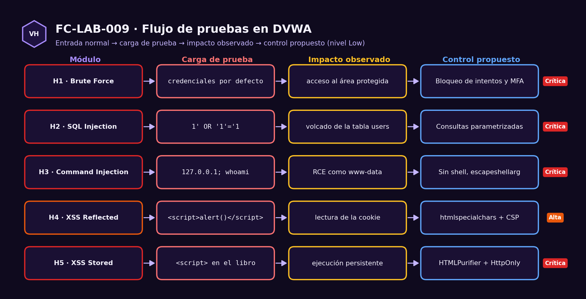

# Procedimiento del FC-LAB-009

Todas las pruebas se hacen en el nivel de seguridad Low. Cada paso indica la captura que lo evidencia en `../evidencias/`.

## Preparación

| Paso | Acción | Evidencia |
| --- | --- | --- |
| 1 | Instalar Docker en Kali y habilitar el servicio. | 01 |
| 2 | Levantar DVWA con `../scripts/levantar-dvwa.sh`. | 02 |
| 3 | Abrir `http://localhost:8080` e iniciar sesión con las credenciales por defecto de DVWA. | 03 |
| 4 | Pulsar Create / Reset Database y volver a iniciar sesión. | 04, 05 |
| 5 | En DVWA Security, fijar el nivel Low. | 06 |

## Pruebas

| Parte | Módulo | Entrada normal | Carga de prueba | Resultado observado | Evidencia |
| --- | --- | --- | --- | --- | --- |
| 7 | Brute Force | Credenciales por defecto | Contraseña incorrecta repetida | Acceso concedido con las credenciales por defecto; los intentos fallidos no se bloquean y los datos viajan por GET en la URL | 07, 07.1 |
| 8 | SQL Injection | `1` | `1' OR '1'='1` y `1'` | Se listan los cinco usuarios; la comilla sola devuelve el error de sintaxis de MariaDB | 08, 08.1, 08.2 |
| 9 | Command Injection | `127.0.0.1` | `127.0.0.1; whoami`, `; ls`, `; pwd`, `; uname -a`, `; cat /etc/passwd` | El servidor ejecuta cada comando como `www-data` y muestra su salida | 09 a 09.5 |
| 10 | XSS Reflected | `Juan` | ``, cambio de fondo con `document.body.style`, `alert(document.cookie)` | El script se ejecuta, modifica el DOM y muestra la cookie de sesión | 10 a 10.3 |
| 11 | XSS Stored | Mensaje de texto | ``, `alert(1)`, `alert(document.cookie)` | El script queda guardado y se ejecuta en cada carga de la página | 11 a 11.3 |

## Cierre

Pulsar Clear Guestbook para borrar los scripts almacenados y detener el contenedor con `Ctrl+C`; al usar `--rm` se elimina con sus datos.
