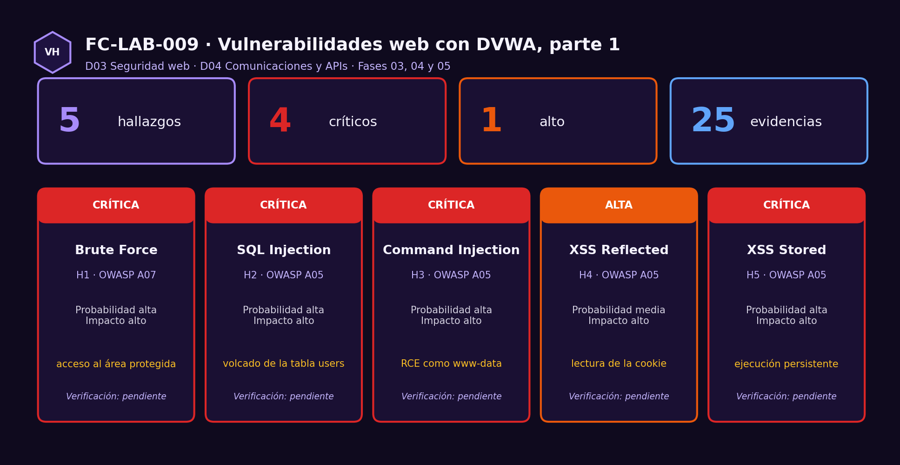

# Hallazgos del FC-LAB-009

Severidad según la rúbrica de `framework/matrices/hallazgos-riesgos.md`. Activo en todos los casos: DVWA en un contenedor local, nivel Low.

| ID | Módulo | OWASP Top 10:2025 | Hallazgo | Probabilidad | Impacto | Severidad | Evidencia |
| --- | --- | --- | --- | --- | --- | --- | --- |
| L09-H1 | Brute Force | A07 Authentication Failures | Credenciales por defecto aceptadas, intentos ilimitados y credenciales en la URL (GET) | Alta | Alto | Crítica | 07, 07.1 |
| L09-H2 | SQL Injection | A05 Injection | La entrada se concatena en la consulta: `OR '1'='1` lista todos los usuarios y el error del motor se muestra completo | Alta | Alto | Crítica | 08 a 08.2 |
| L09-H3 | Command Injection | A05 Injection | Los separadores `;` no se filtran: ejecución de comandos como `www-data` y lectura de `/etc/passwd` | Alta | Alto | Crítica | 09 a 09.5 |
| L09-H4 | XSS Reflected | A05 Injection | El parámetro `name` se refleja sin codificar; el script accede a la cookie de sesión sin `HttpOnly` | Media | Alto | Alta | 10 a 10.3 |
| L09-H5 | XSS Stored | A05 Injection | El libro de visitas guarda y sirve scripts a todos los visitantes en cada carga | Alta | Alto | Crítica | 11 a 11.3 |

La probabilidad del XSS reflejado es media porque requiere que la víctima abra un enlace manipulado; en el almacenado basta con visitar la página.

## Plan de mitigación (fase 05)

| ID | Control propuesto | Verificación (fase 06) |
| --- | --- | --- |
| L09-H1 | Inicio de sesión por POST sobre HTTPS, eliminar las credenciales por defecto, bloqueo temporal y retardo progresivo, CAPTCHA tras varios fallos, doble factor, mensaje genérico de error, contraseñas con bcrypt o Argon2 y token anti-CSRF | Pendiente |
| L09-H2 | Consultas parametrizadas (PDO o `mysqli` con `bind_param`), validación por tipo y lista blanca, cuenta de base de datos con mínimo privilegio y `display_errors` desactivado | Pendiente |
| L09-H3 | No invocar el shell; si es inevitable, `filter_var(FILTER_VALIDATE_IP)` y `escapeshellarg()`, deshabilitar `exec`, `shell_exec` y `system` en `php.ini`, usuario sin privilegios y aislamiento con contenedores o AppArmor | Pendiente |
| L09-H4 | Codificación de salida según contexto con `htmlspecialchars`, validación en el servidor, Content Security Policy sin scripts en línea y cookies `HttpOnly`, `Secure` y `SameSite` | Pendiente |
| L09-H5 | Los controles de L09-H4 más saneamiento del HTML permitido con HTMLPurifier al guardar | Pendiente |

Controles transversales: firewall de aplicaciones web (ModSecurity con OWASP CRS), endurecimiento del servidor, parches al día, registro y monitoreo de eventos con alertas, y pruebas SAST y DAST periódicas con OWASP ZAP.

La verificación queda pendiente: consiste en repetir cada carga en el nivel Impossible de DVWA y registrar si queda bloqueada.
