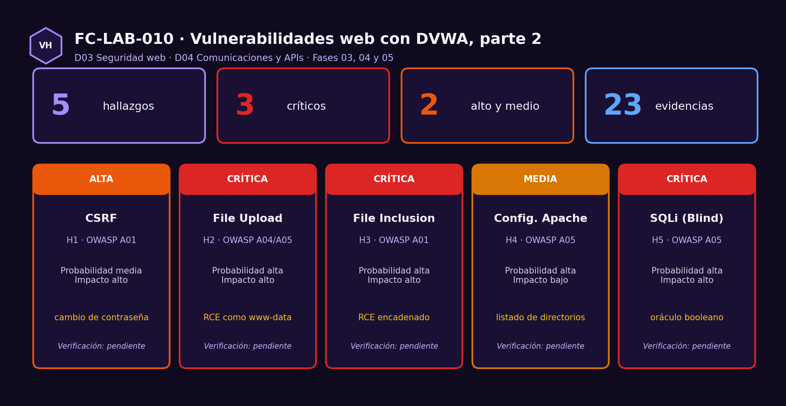

# Hallazgos del FC-LAB-010

Severidad según la rúbrica de `framework/matrices/hallazgos-riesgos.md`. Activo en todos los casos: DVWA en un contenedor local, nivel Low.

| ID | Módulo | OWASP Top 10:2025 | Hallazgo | Probabilidad | Impacto | Severidad | Evidencia |
| --- | --- | --- | --- | --- | --- | --- | --- |
| L10-H1 | CSRF | A01 Broken Access Control | Cambio de contraseña por GET, sin token anti-CSRF ni validación de origen; basta la sesión activa | Media | Alto | Alta | 02-csrf, 02.1 |
| L10-H2 | File Upload | A04 Insecure Design / A05 Injection | El servidor acepta y ejecuta `shell.php`: no valida extensión, tipo MIME ni contenido; ejecución remota como `www-data` | Alta | Alto | Crítica | 03 a 03.4 |
| L10-H3 | File Inclusion | A01 Broken Access Control | Incluye rutas absolutas (`/etc/passwd`) y el `shell.php` subido vía `../`: lectura de archivos y RCE encadenado | Alta | Alto | Crítica | 04 a 04.4 |
| L10-H4 | Configuración Apache | A05 Security Misconfiguration | Listado de directorios habilitado y firma del servidor (`Apache/2.4.25 Debian`) visibles | Alta | Bajo | Media | 04.5 |
| L10-H5 | SQL Injection (Blind) | A05 Injection | Oráculo booleano: la entrada se concatena en la consulta y permite inferir el nombre de la base de datos sin ver datos ni errores | Alta | Alto | Crítica | 05.1 a 05.3 |

La probabilidad del CSRF es media porque requiere que la víctima autenticada abra un enlace preparado; en las demás basta con enviar la carga.

## Plan de mitigación (fase 05)

| ID | Control propuesto | Verificación (fase 06) |
| --- | --- | --- |
| L10-H1 | Token anti-CSRF aleatorio validado en el servidor, cambio por POST, comprobación de `Origin` y `Referer`, pedir la contraseña actual y cookie de sesión con `SameSite` | Pendiente |
| L10-H2 | Lista blanca de extensiones de imagen, verificación del tipo real del contenido, renombrar con nombres aleatorios y guardar fuera de la raíz web o desactivar PHP en la carpeta de subidas | Pendiente |
| L10-H3 | No recibir rutas desde la URL sino un identificador de una lista fija; si se recibe un nombre, normalizar con `basename()` y `realpath()` y restringir al directorio autorizado; `allow_url_include` desactivado y `open_basedir` limitado | Pendiente |
| L10-H4 | Deshabilitar el listado de directorios de Apache y ocultar la firma y versión del servidor | Pendiente |
| L10-H5 | Consultas parametrizadas, validar que el ID sea entero, cuenta de base de datos con mínimo privilegio y limitar y registrar las peticiones repetitivas | Pendiente |

Controles transversales: ejecutar el contenedor con un usuario sin privilegios y el código en solo lectura, deshabilitar `system` y `exec` en PHP, firewall de aplicaciones web (ModSecurity con OWASP CRS), actualizar Apache, PHP y la imagen de Docker de 2018, y pruebas de seguridad periódicas.

La verificación queda pendiente: consiste en repetir cada carga en el nivel Impossible de DVWA y registrar si queda bloqueada.
