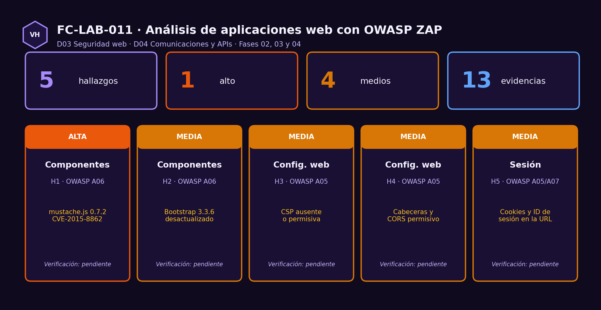

# FC-LAB-011. Análisis de aplicaciones web con OWASP ZAP

| Campo | Descripción / dato requerido |
| --- | --- |
| Identificador | FC-LAB-011 |
| Nombre y versión | Análisis de aplicaciones web con OWASP ZAP: proxy, reconocimiento, escaneo activo y reporte. v1.0, 13/11/2026. |
| Objetivo | Usar OWASP ZAP como proxy de intercepción para capturar el tráfico, hacer reconocimiento (Spider y AJAX Spider), ejecutar un escaneo activo sobre entornos controlados y documentar las salidas de cada módulo (History, Alerts, Spider, Active Scan, HTTP Sessions, AJAX Spider, WebSockets), generando un reporte. |
| Dominio y fase | D03 Seguridad web y D04 Comunicaciones y APIs. Fases 02 Prevención (línea base con el analizador pasivo), 03 Identificación (reconocimiento y escaneo activo) y 04 Análisis (reporte y severidad). |
| Roles | Analista ofensivo (reconocimiento y escaneo): Diego Alberto. Analista defensivo (controles): Diego Alberto. Revisor: Diego Alberto. |
| Entorno y autorización | OWASP ZAP (Apache 2.0) sobre Kali Linux, con el proxy en `127.0.0.1:8090`. Objetivos: DVWA (contenedor `vulnerables/web-dvwa`) en `localhost:8080` y OWASP Juice Shop Demo, ambos diseñados para la práctica, y una plataforma académica A que la guía del laboratorio elaborada por el docente nombra como sitio de prueba controlado. El escaneo activo se ejecutó sobre los entornos de práctica; el objetivo externo se analizó siguiendo esa guía, y en este repositorio se publica anonimizado y sin su URL ni parámetros. |
| Entradas | Proxy `127.0.0.1:8090`, las URL de los objetivos y la opción Automated Scan (Spider + Active Scan) de ZAP. |
| Procedimiento | 1. Instalar y abrir ZAP. 2. Levantar DVWA con [scripts/levantar-dvwa.sh](scripts/levantar-dvwa.sh). 3. Configurar el proxy de Firefox y el puerto en ZAP. 4. Revisar History y Alerts. 5. Reconocimiento con Spider y AJAX Spider. 6. Escaneo activo (Automated Scan). 7. Repetir en Juice Shop y en la plataforma académica A. 8. Generar el reporte. Detalle en [procedimiento/pasos.md](procedimiento/pasos.md). |
| Evidencias | 13 capturas en [evidencias/](evidencias/), numeradas por objetivo (DVWA, plataforma académica A y Juice Shop). No se publican las capturas de reconocimiento y ataque del objetivo externo porque muestran su URL y un token en cada fila; esa parte se documenta con la captura de alertas (sin host) y el resumen anonimizado del reporte. Hashes SHA-256 en `evidencias/hashes.csv`. |
| Criterio de aceptación | Cada módulo de ZAP que aplica queda documentado con su salida, y el reporte reúne las alertas por sitio y nivel de riesgo. |
| Análisis defensivo | Cinco hallazgos (uno alto y cuatro medios) en [resultados/hallazgos.md](resultados/hallazgos.md). Predominan debilidades de configuración y de componentes: política CSP ausente o permisiva, cabeceras de seguridad faltantes, CORS permisivo, gestión de sesión débil y bibliotecas JavaScript desactualizadas (una con CVE conocida). El escaneo activo no reveló vulnerabilidades explotables de inyección en los objetivos externos; sí confirmó la inyección SQL de DVWA ya documentada en el FC-LAB-009. |
| Resultado | Reporte de ZAP con las alertas por sitio y matriz de hallazgos con severidad según la rúbrica del Anexo B. Resumen anonimizado del reporte en [resultados/reporte-zap-resumen.md](resultados/reporte-zap-resumen.md). Pendiente para la fase 06: aplicar los controles de hardening y repetir el escaneo para comprobar que las alertas desaparecen. |

Documentos: guía del docente: [guía](procedimiento/guia.pdf); informe entregado: [informe](resultados/informe.pdf). En ambos se taparon el nombre, la URL y las capturas de la plataforma académica A.

Autor del laboratorio: Diego Alejandro Alberto Cáceres. Corresponde al laboratorio 11 del curso. En este laboratorio académico el autor asumió todos los roles, incluido el de revisor, como admite la sección 3.
