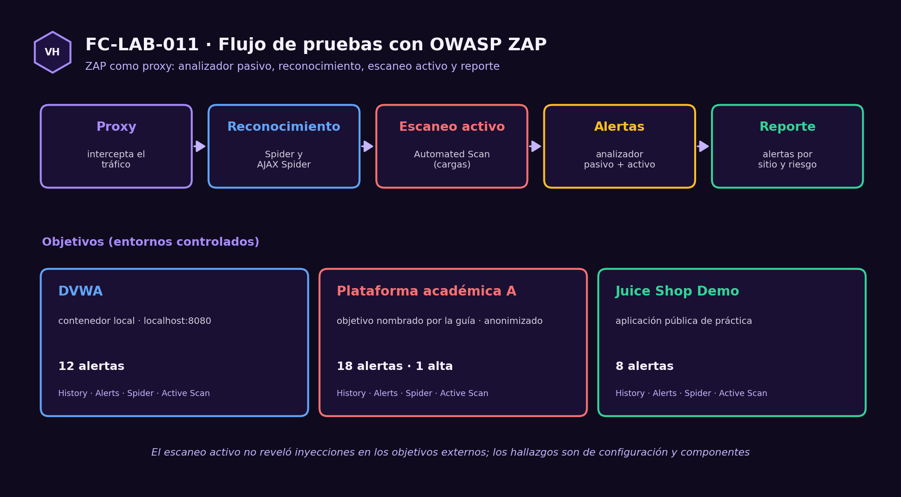

# Procedimiento del FC-LAB-011

ZAP actúa como proxy entre el navegador y cada objetivo. El analizador pasivo levanta alertas con solo navegar; el Spider y el AJAX Spider descubren rutas, y el escaneo activo (Automated Scan) envía cargas de prueba. Cada paso indica la captura que lo evidencia en `../evidencias/`.

## Preparación

| Paso | Acción | Evidencia |
| --- | --- | --- |
| 1 | Instalar y abrir OWASP ZAP (`sudo apt install zaproxy`; `zaproxy`). | 01 |
| 2 | Levantar DVWA con `../scripts/levantar-dvwa.sh`. | 02 |
| 3 | Configurar el proxy de Firefox (`127.0.0.1:8090`). | 03 |
| 4 | Fijar el mismo puerto en ZAP (Tools → Options → Local Proxy). | 04 |

## Módulos de ZAP (sobre DVWA en `localhost:8080`)

| Módulo | Qué hace | Salida observada | Evidencia |
| --- | --- | --- | --- |
| History | Registra todo el tráfico capturado | Peticiones `GET /`, `/dvwa`, `/login.php`; códigos 200, 301, 404 y algún 500 | 05 |
| Alerts | Vulnerabilidades del analizador pasivo | CSP no definida, cookie sin HttpOnly ni SameSite, falta anti-clickjacking, versión del servidor expuesta; el activo marca además inyección SQL | 06 |
| Spider | Reconocimiento de rutas (HTML) | Descubre `/dvwa`, `/login.php`, `/robots.txt` y recursos estáticos | 07 |
| Active Scan | Escaneo activo (cargas de ataque) | Más de 1200 peticiones con pruebas de inyección; confirma la SQLi de DVWA | 08 |

## Pruebas por objetivo (Automated Scan: Spider + Active Scan)

| Objetivo | Entorno | Salidas documentadas | Evidencia |
| --- | --- | --- | --- |
| DVWA | Contenedor local `localhost:8080`, de práctica | History, Alerts, Spider y Active Scan | 05 a 08 |
| Plataforma académica A | Sitio nombrado por la guía del docente como objetivo de prueba controlado | Alerts (18 alertas): una biblioteca JavaScript con CVE, componentes desactualizados, CSP permisiva, ausencia de anti-CSRF y de SRI | 09 |
| Juice Shop Demo | Aplicación pública diseñada para la práctica | Alerts, Spider, AJAX Spider (crawler con navegador real que ejecuta JavaScript) y Active Scan; se observan además canales WebSocket (`socket.io`) | 10 a 13 |

## Reporte

Se generó el reporte HTML de ZAP con las alertas por sitio y nivel de riesgo. En este repositorio se incluye solo su resumen anonimizado (`../resultados/reporte-zap-resumen.md`); el reporte original no se publica porque contiene la URL del objetivo externo, un token de la petición e identificadores de sesión (sección 11.2).

## Cierre

Detener el contenedor de DVWA con `Ctrl+C` (al usar `--rm` se elimina con sus datos) y cerrar ZAP.
