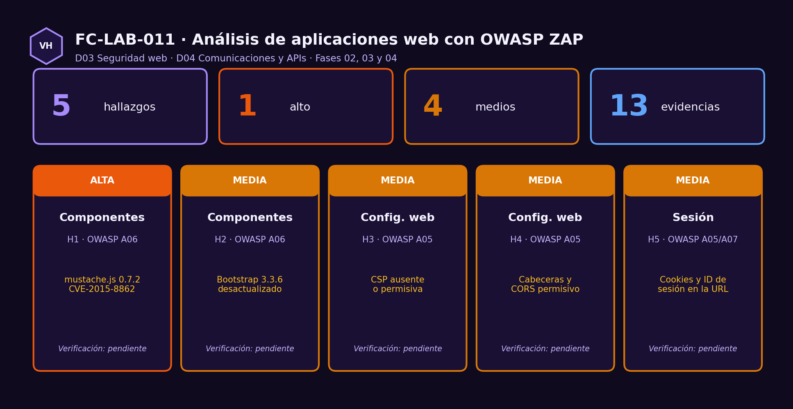

# Hallazgos del FC-LAB-011

Severidad según la rúbrica de `framework/matrices/hallazgos-riesgos.md`. Los hallazgos provienen del analizador de OWASP ZAP; los objetivos son DVWA (`localhost:8080`, de práctica), Juice Shop Demo (pública, de práctica) y una plataforma académica A (objetivo nombrado por la guía del docente, anonimizado en este repositorio).

| ID | Categoría | OWASP Top 10:2025 | Hallazgo | Objetivo | Probabilidad | Impacto | Severidad | Evidencia |
| --- | --- | --- | --- | --- | --- | --- | --- | --- |
| L11-H1 | Componentes | A06 Vulnerable and Outdated Components | Biblioteca JavaScript vulnerable con CVE conocida (mustache.js 0.7.2, CVE-2015-8862) | Plataforma A | Media | Alto | Alta | 09 |
| L11-H2 | Componentes | A06 Vulnerable and Outdated Components | Componentes front-end desactualizados (Bootstrap 3.3.6) | Plataforma A | Media | Medio | Media | 09 |
| L11-H3 | Configuración web | A05 Security Misconfiguration | Política CSP ausente o permisiva: sin CSP, directivas comodín y uso de `unsafe-inline` y `unsafe-eval` | Los tres | Media | Medio | Media | 06, 09, 10 |
| L11-H4 | Configuración web | A05 Security Misconfiguration | Cabeceras de seguridad ausentes (anti-clickjacking, HSTS, X-Content-Type-Options) y CORS permisivo (cross-domain) | Juice Shop y plataforma A | Media | Medio | Media | 06, 10 |
| L11-H5 | Gestión de sesión | A05 Security Misconfiguration / A07 Authentication Failures | Cookies sin `HttpOnly` ni `SameSite` (DVWA) e identificador de sesión en la URL de `socket.io` (Juice Shop) | DVWA y Juice Shop | Media | Medio | Media | 06, 10 |

El escaneo activo (Automated Scan) sobre los objetivos externos no reveló vulnerabilidades explotables de inyección; en DVWA sí confirmó la inyección SQL ya documentada en el FC-LAB-009. Todos los hallazgos de la plataforma académica A son del analizador pasivo (detección de versiones y de configuración), no de explotación.

## Plan de mitigación (fase 05)

| ID | Control propuesto | Verificación (fase 06) |
| --- | --- | --- |
| L11-H1 | Actualizar mustache.js a una versión sin la CVE (≥ 2.2.1) y mantener un inventario de dependencias front-end | Pendiente |
| L11-H2 | Actualizar Bootstrap y las demás bibliotecas a versiones soportadas; revisar con un análisis de composición de software | Pendiente |
| L11-H3 | Definir una política CSP restrictiva, sin comodines ni `unsafe-inline`/`unsafe-eval`, con listas de orígenes explícitas | Pendiente |
| L11-H4 | Enviar las cabeceras `X-Frame-Options`/`frame-ancestors`, `Strict-Transport-Security` y `X-Content-Type-Options`, y restringir CORS a los orígenes necesarios | Pendiente |
| L11-H5 | Marcar las cookies de sesión con `HttpOnly` y `SameSite`, y transportar el identificador de sesión en una cookie en lugar de la URL | Pendiente |

La verificación queda pendiente: consiste en aplicar los controles de hardening y repetir el escaneo con ZAP para comprobar que cada alerta desaparece.
